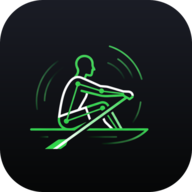
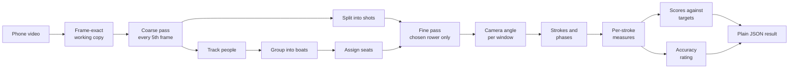
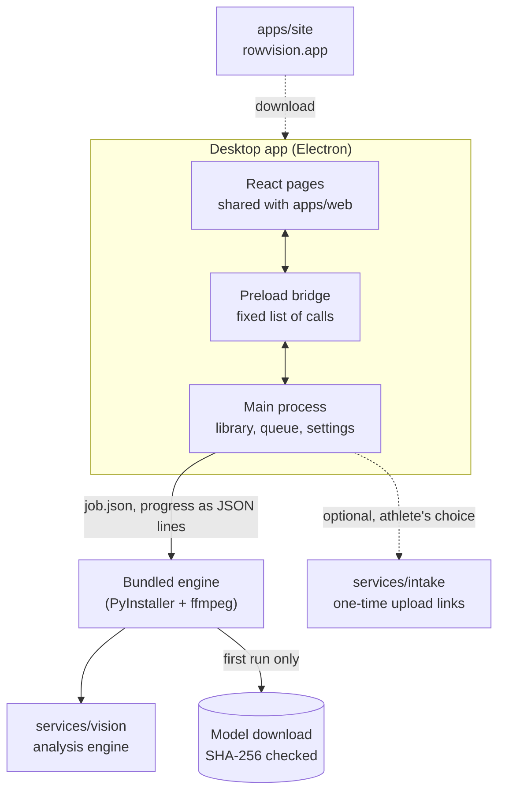

<p align="center">
  
</p>

<h1 align="center">RowVision</h1>

<p align="center">
  <strong>Computer-vision technique analysis for rowers, from ordinary phone footage filmed off a moving launch.</strong><br>
  <a href="https://rowvision.app">rowvision.app</a> · Desktop app for Linux (early preview) · Windows coming soon
</p>

---

RowVision takes a video of a crew on the water, finds the athlete who asked for the analysis, follows their body through every stroke and measures how they move: how far they reach forward at the catch, how far they lean back at the finish, how their legs, body and arms are sequenced, and how their rhythm holds up over a piece. Each measure is compared with targets drawn from published sports-science research, and every result carries an **accuracy rating** that says how far the numbers can be trusted.

The guiding rule of the project is that it would rather say *"not scored"* or *"film closer"* than show a number it cannot defend.

I am a rower, and I built RowVision end to end: the computer-vision engine, the evidence review behind the targets, the desktop app, an earlier web app, the marketing site, and the testing and release tooling around them.

## Contents

- [The problem](#the-problem)
- [What it does](#what-it-does)
- [How the analysis works](#how-the-analysis-works)
- [Being honest about accuracy](#being-honest-about-accuracy)
- [Where the targets come from](#where-the-targets-come-from)
- [Architecture](#architecture)
- [Technology](#technology)
- [Engineering practice](#engineering-practice)
- [Privacy and footage](#privacy-and-footage)
- [Status and known limits](#status-and-known-limits)
- [Repository map](#repository-map)
- [Running it](#running-it)
- [Further reading](#further-reading)

## The problem

Most rowing technique feedback comes from a coach watching from a launch, or from video reviewed by eye afterwards. Motion-capture tools exist, but they need markers, sensors or a rowing machine in a lab. What a club rower actually has is a shaky phone clip, filmed from a moving boat, often of a whole eight at low resolution.

That footage is hard for computer vision:

- **Rowers are small.** In typical club footage a rower's trunk is 14–32 pixels long, so one pixel of error moves a body angle by about 2°.
- **The camera moves.** It pans, zooms, drifts round the bow or stern, and changes between side-on and nearly end-on within one clip.
- **People overlap.** Eight rowers and a cox sit in a line, hiding each other, and the hull hides most of each rower's legs.
- **Pose models are confidently wrong.** Off-the-shelf models often score hidden hips and knees low when they are placed correctly, and score bad placements high.
- **"Good technique" is contested.** Studies describe what skilled rowers do, mostly on rowing machines, not what is ideal on the water.

RowVision is an attempt to get trustworthy, explainable feedback out of that footage, and to be open about where it cannot.

## What it does

1. **Add a clip** and pick up to 60 seconds of it.
2. **Say who you are:** tap yourself on a clear frame, and give the boat class (single to eight), your side (stroke side, bow side or sculling) and your seat.
3. **Leave it to run.** Analysis runs locally on the user's own computer; nothing is uploaded.
4. **Read the result:** an accuracy rating, scores for the catch and finish, and the one or two things to work on next.
5. **Check any number:** open a measure to see the freeze frames it came from, the target band, the studies behind the target and a 3D model of the rower posed at the target angles.
6. **Step through the footage** frame by frame with the tracked skeleton drawn over it.
7. **Look back over past clips** to see progress, with older results labelled when they were measured by an older version of the engine rather than silently changed.

Measures include forward body angle at the catch, layback at the finish, knee angles (shown as a rough guide, never scored), whether the legs lead the body off the catch, drive and recovery times and their ratio, stroke rate and its steadiness, body swing, arm timing, stroke length, catch timing against the rower you follow, and "fade" from the first half of a piece to the second.

Coaches or athletes can adjust each target range in Settings and choose which measures count towards the score. Scores are recomputed from the saved measurements instantly, without running the analysis again.

## How the analysis works

The engine is a Python package (`services/vision/rowvision`, about 4,000 lines) built around a **coarse pass** that understands the whole clip and a **fine pass** that measures only the chosen rower.



**Frame-exact video.** Phone footage has long gaps between keyframes, and OpenCV's seek lands 2–5 frames early on HEVC clips. At 30 fps that is enough to move the catch. The engine never seeks: it makes one H.264 working copy that is used for both analysis and viewing, and reads frames in order (`video.py`, [ADR 1](docs/adr/0001-one-working-copy.md)).

**Detection and pose.** People are found with YOLOX and their 17 COCO joints placed with RTMPose, both run through ONNX Runtime on the CPU via rtmlib. The models sit behind an interface (`pose.py`) so tests can replace them.

**Shots.** Real clips change framing and angle, so the video is split into shots and frames that are end-on, blurred or mid-zoom are set aside (`shots.py`).

**Tracking, boats and seats.** People are followed across frames with duplicate suppression and gap filling (`tracking.py`), grouped into boats when several are in view (`boats.py`), and ordered into seats using the crew's facing direction (`seats.py`). The athlete's tap, or their seat number, then picks who to measure.

**Camera angle.** The engine estimates how far the camera is from side-on, from the rower's own proportions, over short windows (`view.py`). Up to 45° off side-on, angles are corrected for the foreshortening (`geometry.py`). Past 60° the footage is not used. If the launch crosses to the other side of the boat, the crew appears to turn round; `sides.py` finds the crossing so seat order and directions stay right.

**Strokes.** The facing direction and a "reach" signal from the hands and shoulders split the clip into strokes and mark each catch and finish (`strokes.py`).

**Measures and scores.** Each stroke yields a set of measures (`metrics.py`), with readings a human body could not make thrown out rather than averaged in. Scores fall away smoothly: a body angle loses half its points 5° outside the target and all of them at 10° (`scoring.py`). An overall score needs both a catch and a finish measure, so a clip cannot score well on rhythm alone.

**Crew timing.** Being early or late only means something against the rower you follow, so sweep rowers are timed against the rower nearest the stern on their own side, and scullers against stroke (`timing.py`).

**Remeasuring.** Finding joints is the slow part. The joints are saved with each result, so newer measuring code can be applied to an older result in seconds (`remeasure.py`).

**Versioning.** `version.py` hashes the analysis code and target files. Every result records what measured it, and results from older code are labelled, never silently mixed with new ones.

## Being honest about accuracy

The accuracy rating is the share of joint-angle measurements expected to fall within ±5° of the truth. It depends only on measurement quality, not on how good the rowing is. Bands are Excellent (90%), Great (80%), Good (70%), Fair (60%) and Poor. When the rating is Poor, the overall score stays hidden until the viewer accepts a warning.

To ground it, I built a labelling tool (`apps/preview`) and hand-labelled joints on real footage:

| Calibration figure | Value |
|---|---|
| Labelled frames used | 108, from 12 clips |
| Keypoint error that matches the labels | 2.0 px |
| Body angle within 5° of the label | 48% of frames (±9 points), typical gap 5° |
| Knee angle within 5° of the label | 21% of frames, typical gap 18° |

That knee result is why knee angles are shown as a guide and never scored. The error grows as the rower gets smaller: the typical gap is 25° when the trunk is under 22 px tall, and 9° from 34 px up. A bigger pose model (RTMPose-x) did no better, so knee angles are hidden for rowers under 34 px, with a prompt to film closer. `services/vision/scripts/knee_bench.py` scores pose setups against the labels. The rating takes rower size in pixels, camera angle, visibility and tracking into account, and the app gives **"film closer"** or **"film side-on"** advice instead of scores when footage is not good enough.

Correctness is also tested against **synthetic ground truth**: `synthetic.py` generates a rower with exactly known joint angles, viewed by a virtual camera at chosen angles, and the tests check the pipeline measures those angles back.

## Where the targets come from

The targets are based on a structured PubMed search across 12 topics (602 records, 477 mentioning rowing), screened down to **130 studies** listed in [docs/research/studies.md](docs/research/studies.md). The [evidence summary](docs/research/README.md) explains what the evidence supports and where it runs out.

| Measure | Target | Main sources |
|---|---|---|
| Forward body angle at the catch | 26–31° | Cardoso 2024; Penichet-Tomas 2025 |
| Layback at the finish | 20–25° | Cardoso 2024 |
| Knee angle at the catch (unscored) | 50–55° | Bell 2013; Penichet-Tomas 2025 |
| Knee angle at the finish (unscored) | 175–180° | Judgement informed by Bell 2013 |
| Drive share of the stroke | ~39–47%, rising with rate | Engstrom 2023 |
| Legs lead the body | Direction only | Rowing Canada and British Rowing technique models |

The targets live in a data file ([general.yaml](services/vision/reference/general.yaml)) with their sources as PubMed IDs, rather than in code, so a coach can review and change them. The summary is explicit about the limits: most data comes from rowing machines, samples are small and mostly adult, and measured values are not ideal values.

## Architecture

The product went through two shapes, and both are in the repository.

**First, a web app** (`apps/web`, `services/worker`, `supabase`): an invite-only Next.js site with email sign-in, uploads to storage, a Postgres job queue with row-level security, and a worker that claimed jobs, analysed them and emailed the athlete. The worker only ever connected outward, so it could run on a home PC behind a router ([ADR 2](docs/adr/0002-worker-connects-outward.md)).

**Then, a desktop app first** ([ADR 5](docs/adr/0005-desktop-app-first.md)). One clip took 11 minutes on 8 CPU cores, and hosting GPU analysis for free was not realistic. Running on the athlete's own computer costs nothing, keeps footage off any server, and removes the hardest privacy questions. The web code was not thrown away: the desktop app imports the results page, frame viewer, 3D model and logic straight from `apps/web`, so both share one implementation.



- **Library on disk.** Each clip is a folder. Its state is read from which files exist (`summary.json` done, `pause.json` needs a tap, `state.json` stopped), so a clip cut off by closing the app simply restarts. The user's original video is never copied or changed.
- **Engine as a separate process.** The Electron main process writes a job file, starts the bundled engine and reads progress lines. A fake engine that speaks the same protocol makes the app fully testable without models.
- **Models on first run.** The ~145 MB of models are downloaded on first run with progress, cancel and retry, from the official mirror with a fallback, and every file is checked against a pinned SHA-256 before use.
- **Installers.** A Linux AppImage and `.deb`, built to run on glibc 2.30 and later, with a static AppImage runtime so FUSE is not needed. A Windows NSIS installer builds in CI and is still being tested.

## Technology

| Area | Tools |
|---|---|
| Computer vision | Python 3.12, NumPy, OpenCV, ONNX Runtime, rtmlib (YOLOX, RTMPose), ffmpeg |
| Desktop app | Electron, React 19, TypeScript, Vite, electron-builder, PyInstaller |
| Web app | Next.js 16, React, TypeScript, CSS Modules |
| Data and auth (web) | Supabase: Postgres, row-level security, storage, email sign-in |
| Marketing site | Vite, vanilla JS, Cloudflare Pages and R2 |
| 3D | Three.js for the rower model posed at target angles |
| Testing | pytest, Hypothesis, Vitest, Node test runner, Playwright, Cucumber, pgTAP |
| Quality | Ruff, mypy, ESLint, TypeScript strict mode |
| Delivery | GitHub Actions, Docker, Docker Compose |

## Engineering practice

**Tests.** Around 900 automated tests across the stack:

| Suite | Count (approx.) |
|---|---|
| Python: engine, worker, labelling tool | 477 |
| TypeScript and JS unit and app tests: web, desktop, site, intake | 357 |
| Database tests (pgTAP), including row-level security | 76 |
| Acceptance scenarios (Cucumber) | 6 |

The desktop app is tested end to end with Playwright against both the built app and the **installed** app, which downloads the real models and runs the bundled engine on a clip generated by the bundled ffmpeg, with no Python on the path.

**Real footage as well as tests.** Twice, a tracking change passed every test but made real clips worse. Tracking and scoring changes are now compared across every real clip before merging, and replayed from the app's own working copy.

**CI.** GitHub Actions runs lint, type checks and tests per component, only for the parts a change touches. A dedicated job fails the build if any video, image frame or keypoint file is tracked. Installer builds and Windows runs are manual, to keep within the free minutes.

**Process.** Work runs from GitHub issues and milestones, on feature branches, through 100+ merged pull requests. Significant decisions are written up as [architecture decision records](docs/adr). Interface designs were chosen from rounds of mock-ups before being built, and recorded in [DESIGN.md](DESIGN.md).

**Security of the desktop app.** The page has no Node access (`contextIsolation`, `sandbox`, no `nodeIntegration`). The preload exposes a fixed list of calls, and the main process checks every argument and that each call comes from the app's own page. Video and frame data are served from a custom protocol that checks clip ids and file names so nothing outside the library can be read. There is a strict content security policy, no remote requests, no navigation and every permission refused.

**Accessibility.** Keyboard control for all frame stepping and zoom, readable contrast, and colour never carrying meaning alone. Athletes can change the app's colours.

## Privacy and footage

Rowing footage shows identifiable athletes, many of them juniors. Because of that:

- **No real footage, frames, overlays, keypoints or labels are in this repository**, and CI enforces it. Tests use generated footage and a synthetic rower.
- The only exceptions are the short clips and pose files behind the public site, which the people in them agreed to.
- The desktop app analyses on the user's own computer and sends nothing unless the athlete chooses to send a clip.
- The web app deleted video after 30 days and kept only the scores. See [what is stored](docs/privacy.md).
- The first version is for adults only. Anything for under-18s needs parental consent, a safeguarding review and a legal review first.

## Status and known limits

RowVision is an **early preview**. The site is live at [rowvision.app](https://rowvision.app) with a Linux download. Things I know are not right yet, and track openly as issues:

- **Results are not yet stable enough to invite testers** (#134). The same clip can give a different accuracy rating depending on whether the rower is picked by a tap or by seat number, and catch timing is a few frames off on many clips.
- **Most sample clips rate Poor.** They are compressed WhatsApp copies at 848×478, which is the main reason closer, sharper footage is needed.
- **Legs filmed from an angle are placed badly,** so they are drawn dashed with a "?" instead of being scored.
- **Multiple boats and very long tracks** still lose rowers in some clips (#7).
- **Blade height** was prototyped with a custom detector trained on 294 hand labels. It found the right blade 75% of the time on unseen clips, but the height itself was lost in pixel noise, so it is parked and not shipped.
- **The targets have not been reviewed by a coach,** and the model weight licences need checking before any commercial use.

## Repository map

| Folder | What it is |
|---|---|
| [`services/vision`](services/vision) | The analysis engine: tracking, seats, shots, camera angle, strokes, measures, scoring and accuracy |
| [`services/worker`](services/worker) | Runs the engine: the desktop entry point, model download and checks, the working copy, and the web job queue |
| [`apps/desktop`](apps/desktop) | The Electron desktop app, its installers and tests |
| [`apps/web`](apps/web) | The Next.js web app, kept as the owner's preview. Its results page, viewer and logic are shared with the desktop app |
| [`apps/site`](apps/site) | The marketing site at rowvision.app, with a scroll-driven film and interactive explainers fed by real engine output |
| [`apps/preview`](apps/preview) | The original local tool, now used to hand-label joints and blades for calibration |
| [`services/intake`](services/intake) | Receives clips athletes choose to send, through one-time upload links |
| [`supabase`](supabase) | Database schema, row-level security, queue functions and their tests |
| [`docs`](docs) | Plans, decisions, research, feasibility and runbooks |

## Running it

Python runs inside Docker, so the host only needs Docker and Node 26.

```bash
# Engine tests
docker build -t rowvision-vision:dev services/vision
docker run --rm -v "$PWD/services/vision:/app" -w /app rowvision-vision:dev pytest

# Desktop app, with a stand-in engine
cd apps/desktop
npm ci && npm run build && npm start
npm test            # unit tests
npm run test:app    # end-to-end, on a generated clip (needs ffmpeg)

# Desktop app with the real engine (Linux, Docker)
npm run start:engine

# Linux installer, built locally
bash scripts/build-installer.sh

# Marketing site
cd apps/site && npm install && npm run dev
```

The web app, database and worker are covered in the [runbook](docs/runbook.md), and the desktop app in its [README](apps/desktop/README.md).

## Further reading

- [Feasibility on real launch footage](docs/feasibility.md): the first experiment, and the limits it found
- [Evidence summary](docs/research/README.md) and [all 130 studies](docs/research/studies.md)
- [Footage survey](docs/footage-survey.md): what the sample clips can and cannot show
- [Desktop plan](docs/desktop-plan.md) and [web app plan](docs/web-app-plan.md)
- [Architecture decision records](docs/adr)
- [Product brief](PRODUCT.md) and [design system](DESIGN.md)
- [Privacy](docs/privacy.md)

## Licence

Copyright © 2026 Fionn Mowlds. All rights reserved. The source is public so that it can be read and reviewed. It is not licensed for reuse, copying or redistribution.
